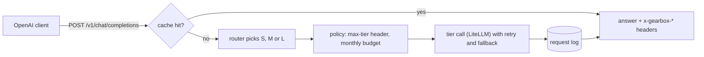

# Gearbox

[](https://github.com/Utsav0706/gearbox/actions/workflows/ci.yml)

An LLM auto-router. An app sends a chat request to Gearbox as it would to any model;
Gearbox predicts the **cheapest model tier that will still answer it well**, calls that
model, handles failures, and logs the cost, latency and reason for every route.

> **Gearbox cuts LLM cost by 93% at 95% of quality** against always using the large
> model (Claude Sonnet 5.5), on 119 held-out prompts (95% intervals: 91-94% saved,
> 90-99% quality). Reproduce with `py -m gearbox.eval` (free: replays stored answers).

The honest reading: on these prompts the medium tier (Claude Haiku 5.5) is good enough
so often that the best router mostly learns to pick it, and always-Haiku scores the
same. A perfect router would reach 98% quality at 13% of the cost; which prompts truly
need the large model proved hard to predict from the prompt alone.


| Tier | Model | Price (USD per million tokens, in/out) |
|---|---|---|
| S | `llama3.2:3b` on Ollama, local | free |
| M | Claude Haiku 5.5 | 0.10 / 0.50 |
| L | Claude Sonnet 5.5 | 2.00 / 10.00 |

Model names and prices live in [`config.yaml`](config.yaml), so a tier can be swapped
without code changes. Gearbox is one of four connected projects:
[Scout](https://github.com/Utsav0706/scout) (research agent), Gearbox (router), Dyno
(eval harness) and Pitwall (LLMOps).

## How it works



Each answer says what happened in its headers: `x-gearbox-tier`, `x-gearbox-model`,
`x-gearbox-cost` (GBP), `x-gearbox-router`, `x-gearbox-cache`, and `x-gearbox-policy` or
`x-gearbox-fallback` when a limit or a failure changed the tier. The full request path,
the training data and the trade-offs are in [`docs/design.md`](docs/design.md); common
questions in [`docs/faq.md`](docs/faq.md).

## Router comparison

On the 119 held-out prompts of dataset v2, with quality and cost relative to always
using tier L ([`reports/eval.md`](reports/eval.md) has the intervals and pass rates):

| Strategy | Quality | Cost saved | Picks S / M / L | Routing time (p50) |
|---|---|---|---|---|
| always-L (Sonnet) | 100% | 0% | 0 / 0 / 119 | n/a |
| always-M (Haiku) | 94.7% | 94.0% | 0 / 119 / 0 | n/a |
| always-S (local) | 57.3% | 100% | 119 / 0 / 0 | n/a |
| v1-rules: keyword rules | 68.0% | 97.5% | 87 / 30 / 2 | under 1 ms |
| v2-llm: Haiku classifies the prompt | 90.6% | 80.5% | 31 / 82 / 6 | 1,952 ms |
| **v3-embed: embeddings + logistic regression** | **94.7%** | **92.9%** | 0 / 117 / 2 | 36 ms |
| oracle: perfect labels | 98.4% | 86.8% | 52 / 57 / 10 | n/a |

v2's cost includes its own classifier call on every request. A live run of the 119
prompts through the API gave 94.5% quality and 92.5% saved, matching the replay.

## Why X over Y

- **Embeddings + logistic regression over a fine-tuned transformer.** 481 labelled
  training prompts are far too few to fine-tune one; the regression trains in a second,
  gives probabilities the threshold can use, and its weights are a small JSON file.
- **Labels from an LLM judge, checked against people.** Most prompts have no single
  correct string. The judge (Claude Sonnet 5.5) scores against reference answers and
  agreed with blind human scores on pass/fail 82.5% of the time (Cohen's kappa 0.65).
- **Offline replay as the main eval.** Every test prompt already has every tier's answer
  and score, so an eval is a lookup: free and identical on every run. A live run through
  the API checks it.
- **LiteLLM, pinned, as the gateway.** One call shape for the local model and both
  Claude models. Pinned to a release at least two weeks old after its March 2026 PyPI
  compromise, with its copy-`.env`-into-the-environment default turned off.
- **Exact-match cache over a semantic one.** It can never answer a slightly different
  question with a cached answer.
- **Downgrade on budget over rejecting.** When the monthly budget is spent, requests go
  to the free tier and the response says so, so the app keeps working.

More decisions, with what each replaced, are in [`docs/design.md`](docs/design.md#5-decisions).

## Cost and limits

- **Running cost:** about GBP 0.32 per 1,000 requests on the test mix, against GBP 4.52
  for always using Sonnet. `policy.monthly_budget_gbp` (GBP 5 by default) caps it.
- **Building it** (dataset answers, judging, probes, the live eval) cost about GBP 4.85
  in API calls.
- **Latency:** v3 adds about 36 ms to decide; a whole request took 2.8 s at p50 and
  12.8 s at p95 in the live run (long answers dominate).
- **Limits:** the test prompts are public benchmarks, not real traffic; 119 prompts
  give wide quality intervals; the router reads only the last user message; streaming,
  tool calling and images are rejected; `temperature` is not forwarded; the budget is
  global, not per user; prices in `config.yaml` need updating when Anthropic changes them.

## Run it locally (Windows PowerShell)

```powershell
py -m venv .venv
.venv\Scripts\python.exe -m pip install -e ".[dev]"
copy .env.example .env    # then paste your Anthropic key into .env
.venv\Scripts\python.exe -m alembic upgrade head    # creates the local request log
.venv\Scripts\python.exe -m gearbox.service         # http://127.0.0.1:8002
```

Tier S needs [Ollama](https://ollama.com) with `ollama pull llama3.2:3b`. Then point any
OpenAI client at it:

```python
from openai import OpenAI

client = OpenAI(base_url="http://127.0.0.1:8002/v1", api_key="unused")
reply = client.chat.completions.create(
    model="auto",  # or "S", "M", "L" to pin a tier
    messages=[{"role": "user", "content": "What is 17 * 23?"}],
)
```

Send `x-gearbox-max-tier: M` to cap a request's tier. `GET /health` and
`GET /stats?hours=24` (cost and route split) are also served.

With Docker, `docker compose up --build` starts the API with Postgres (request log) and
Redis (answer cache) on http://localhost:8002; tier S still uses Ollama on the host. Set
`LANGFUSE_PUBLIC_KEY` and `LANGFUSE_SECRET_KEY` in `.env` to send one trace per request
(routing decision, tokens, cost; never prompt or answer text) to Langfuse.

## Eval and dashboard

```powershell
.venv\Scripts\python.exe -m gearbox.eval          # headline + reports/eval.md (free)
.venv\Scripts\python.exe -m gearbox.eval live     # through the running API (paid; --yes)
.venv\Scripts\python.exe -m pip install -e ".[dashboard]"
.venv\Scripts\python.exe scripts\dev_dashboard.py # http://127.0.0.1:8502
```

The dashboard shows spend over time, requests per tier and recent requests from the
request log, plus the eval's cost-vs-quality chart. Tests:
`.venv\Scripts\python.exe -m pytest`. On Linux, `make check`, `make eval` and
`make dashboard` do the same.

## Repository layout

| Path | What |
|---|---|
| `src/gearbox/service/` | The API: request pipeline, cache, policy, request log |
| `src/gearbox/routers/` | Router interface and registry; v1 rules, v2 LLM, v3 embeddings; comparison |
| `src/gearbox/data/` | Dataset build, answering, judging, labels, train/test split |
| `src/gearbox/eval/` | Offline and live eval, cost-vs-quality chart |
| `src/gearbox/dashboard/` | Streamlit dashboard |
| `data/v1`, `data/v2`, `data/probe` | Prompts, answers, judgments, labels (each with a README and manifest) |
| `models/router_v3.json` | Trained router weights |
| `prompts/` | Judge rubric and classifier prompt, versioned |
| `reports/` | Eval, router comparison, probe |
| `migrations/` | Alembic schema migrations |

## How it was built

| Step | What |
|---|---|
| M0 | Skeleton: typed config, JSON logging, tests, CI |
| M1 | Tier clients over LiteLLM with GBP cost tracking; local model chosen by benchmark |
| M2 | 450-prompt dataset from pinned public benchmarks |
| M3 | Every prompt answered by every tier (Message Batches) |
| M4 | LLM judge, labels, 40 blind hand labels (kappa 0.65), train/test split |
| M5 | Three routers behind one interface, compared |
| Probe + v2 | Where the large model wins; 150 hard prompts added; labelling rule fixed |
| M6 | OpenAI-compatible API with a request log |
| M7 | Cache, budget policy, fallback, canary, tracing, Docker Compose |
| M8 | Offline and live eval, cost-vs-quality chart, dashboard |
| M9 | Design doc, FAQ, this README |
