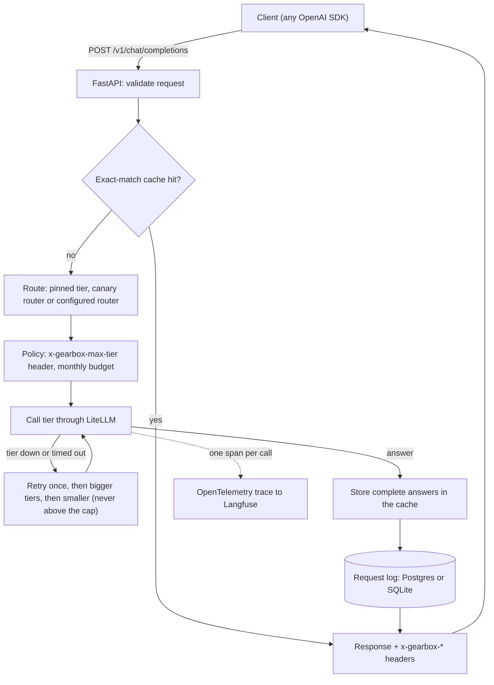
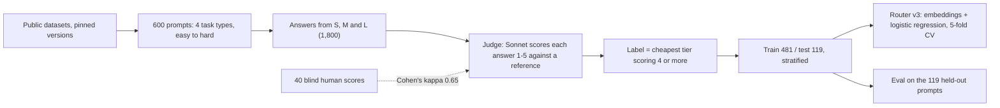

# Gearbox design

Gearbox is an OpenAI-compatible API that sits between an application and three model
tiers. For each request it picks the cheapest tier likely to answer well, calls it,
recovers from failures and records what happened. This document explains how a request
is handled, how the router was trained and measured, and why each part is built the
way it is.

| Tier | Model | Price (USD per million tokens, in/out) |
|---|---|---|
| S | `llama3.2:3b` on Ollama, local | free |
| M | Claude Haiku 5.5 | 0.10 / 0.50 |
| L | Claude Sonnet 5.5 | 2.00 / 10.00 |

## 1. A request, step by step

The steps live in `src/gearbox/service/pipeline.py`, one short block each, in this
order:

1. **Cache.** The key is a hash of the messages (with runs of whitespace collapsed), the
   requested model and the token limit. A hit costs nothing and skips routing.
2. **Route.** `model: "S" | "M" | "L"` pins a tier. Otherwise the router reads the last
   user message and returns a tier plus a one-line reason. A configured canary sends a
   fixed share of requests (by a hash of the request id) to a second router.
3. **Policy.** Limits can only lower the tier: the caller's `x-gearbox-max-tier` header,
   and the monthly budget. Once this month's logged spend reaches the budget, requests
   drop to tier S. Any change is reported in `x-gearbox-policy`.
4. **Call with fallback.** If the tier is unavailable (down, timed out, rate-limited, or
   the prompt is too long for it), retry once, then try bigger tiers up to the cap, then
   smaller ones. A request the model rejects as invalid is not retried elsewhere,
   because every tier would reject it.
5. **Store** complete answers (not ones cut off by the token limit).
6. **Log** one row per request, success or failure.

## 2. How the router learned

- **Prompts.** Dataset v1 has 450 everyday prompts (MT-Bench, HumanEval, MBPP, GSM8K,
  MATH-500, TriviaQA, TruthfulQA, Dolly). A 30-prompt probe showed where Sonnet beats
  Haiku (niche facts, competition maths), so dataset v2 adds a 150-prompt hard slice
  (AIME 2025, MMLU-Pro, SimpleQA). Every source file is pinned to a commit and every
  sample is seeded, so the data rebuilds byte for byte.
- **Answers.** Tier S answered on a laptop GPU. Tiers M and L answered through
  Anthropic's Message Batches API at half price, sending exactly the request the live
  service sends.
- **Judge.** Sonnet at low effort scores correctness, completeness and clarity, then an
  overall 1-5. It never sees which tier wrote an answer, and it gets the reference
  answer when the dataset has one. Two rules are enforced in code: an empty answer
  scores 1, and the overall score can't exceed correctness. On 40 blind human scores,
  pass/fail agreement was 82.5% (Cohen's kappa 0.65). Every disagreement had the judge
  stricter than the human, which pushes labels towards bigger tiers: the safe
  direction.
- **Labels.** The cheapest tier scoring 4 or more. When no tier passes, the tier with
  the best score, cheapest on a tie. (The first rule, "else L", taught the router to
  send questions no model could answer to the most expensive one.)

## 3. The three routers

All three implement `async route(prompt) -> Route(tier, reason)` and register by name,
so the service and the eval treat them the same way.

| Router | How it decides | Routing time (p50) | Result on the test split |
|---|---|---|---|
| v1-rules | Regular expressions: proofs to L; algorithms, multi-step maths and factual questions to M; everything else to S | under 1 ms | 68% quality, 97.5% saved: sends too much to S |
| v2-llm | Haiku reads the prompt and returns `{"tier", "reason"}` as JSON; falls back to M if the reply is unreadable | ~2 s | 91% quality, 80.5% saved (its own call costs nearly as much as Haiku answering) |
| v3-embed | `bge-small-en-v1.5` embedding, multinomial logistic regression, then the cheapest tier whose cumulative probability reaches a threshold | ~36 ms | 95% quality, 93% saved |

v3's settings (regularisation, class weighting, threshold) are chosen by 5-fold cross-
validation on the training split only. Each setting is scored by routing cost, where an
under-route (too small a tier, so a worse answer) counts twice as much as an over-route
(too big a tier, so only wasted money). The trained weights are stored as JSON in
`models/router_v3.json`, not as a pickle: loading the file cannot run code, and changes
show up as a readable diff.

The main finding: whether the small model gets a prompt right is close to unpredictable
from the prompt (57% cross-validated accuracy against 54% for always guessing the
majority answer), and so is which prompts only Sonnet answers well. A router that
cannot predict those cases does best by picking the medium tier almost every time, and
that is what v3 learned.

## 4. What is recorded

| Where | What | Never |
|---|---|---|
| Request log (`request_log` table) | request id, time, router, tier, model, routing reason, tokens, GBP cost, latency, routing time, cache hit, fallback used, error | prompt or answer text |
| Trace (Langfuse, if keys are set) | one root span per request with the same metadata; one generation span per model call, with tokens and USD cost | prompt or answer text |
| Cache (memory or Redis, 1-day expiry) | the answer text, under a hash of the request | the prompt itself |
| Logs (stdout, JSON lines) | one line per model call and per request | prompt or answer text |

`GET /stats` and the Streamlit dashboard read the request log. The schema is created by
Alembic migrations, never by the app at startup, and a test checks that the migrations
match the models.

## 5. Decisions

| Choice | Instead of | Why |
|---|---|---|
| LiteLLM, pinned to an exact release at least two weeks old | Separate SDK clients per provider | One OpenAI-shaped call for the local model and both Claude models. Pinned and lagged because its PyPI package was briefly compromised in March 2026. Its default mode copies `.env` into the process environment, so Gearbox switches that off. |
| Logistic regression on sentence embeddings | Fine-tuning a BERT-style classifier | 481 training examples are far too few to fine-tune a transformer; the regression trains in a second, gives usable probabilities for the threshold, and its weights are a 17 KB JSON file. |
| An LLM judge with reference answers, checked against human scores | Exact-match grading only | Most prompts (writing, explanations, code) have no single right string; the reference keeps the judge factual, and kappa shows how far it can be trusted. |
| Message Batches for dataset answers and judging | Live API calls | Half the price for work that does not need an answer in seconds. |
| Offline eval that replays stored answers | Re-running every model for every eval | Free and exactly reproducible; a separate live run through the API confirmed it (94.5% vs 94.7% quality). |
| Exact-match cache | Semantic cache (similar prompts) | No risk of answering a different question; a semantic cache needs its own evaluation. |
| Monthly budget that downgrades to the free tier and says so | Rejecting requests over budget | The app keeps working; the response header makes the downgrade visible. |
| Sync SQLAlchemy, writes moved off the event loop | An async database driver | One small insert per request; a thread call is enough, with one less dependency. |
| OpenTelemetry exported to Langfuse | Langfuse's own SDK | The vendor-neutral standard, also used by Scout; switching backends is one URL. |

## 6. Connection points

- **Routers by name.** A new router (for example a fine-tuned model served over HTTP)
  registers under a new name and is selected in `config.yaml`, or trialled first on a
  share of traffic through `routing.canary`.
- **OpenAI-compatible endpoint.** Any OpenAI client works by changing its base URL.
  Scout calls models through the Anthropic Messages format, so connecting it means
  adding a thin `/v1/messages` endpoint in front of the same pipeline.
- **Traces and the request log** carry the router, tier, cost and reason for every
  request, ready for an evaluation harness or a monitoring stack to read.
