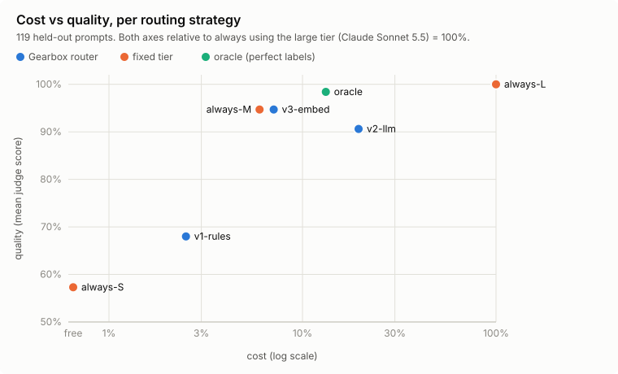

# Eval: cost vs quality

> **Gearbox (v3-embed) cuts LLM cost by 93% at 95% of quality, against always using the large tier, on 119 held-out prompts (95% CI: saved 91-94%, quality 90-99%).**

Generated by `py -m gearbox.eval` from stored answers and judge scores (`data/v2`, test split), so it costs nothing and gives the same numbers every run.
Quality = mean judge score (1-5) as a % of always-L's; cost = answers at list price plus the cost of routing itself, as a % of always-L. Intervals are 95% bootstrap intervals over the test prompts.

| strategy | quality | 95% CI | pass rate | cost vs L | saved | 95% CI | per 1k requests | picks S/M/L | routing p50 / p95 |
|---|---|---|---|---|---|---|---|---|---|
| always-S | 57.3% | 51-64% | 32.8% | 0.0% | 100.0% | 100-100% | GBP 0.000 | 119/0/0 | 0 / 0 ms |
| always-M | 94.7% | 90-99% | 78.1% | 6.0% | 94.0% | 93-95% | GBP 0.269 | 0/119/0 | 0 / 0 ms |
| always-L | 100.0% | 100-100% | 84.0% | 100.0% | 0.0% | 0-0% | GBP 4.518 | 0/0/119 | 0 / 0 ms |
| oracle | 98.4% | 96-100% | 85.7% | 13.2% | 86.8% | 78-94% | GBP 0.595 | 52/57/10 | 0 / 0 ms |
| v1-rules | 68.0% | 61-75% | 45.4% | 2.5% | 97.5% | 96-99% | GBP 0.115 | 87/30/2 | 0 / 0 ms |
| v2-llm | 90.6% | 86-95% | 74.0% | 19.5% | 80.5% | 70-90% | GBP 0.882 | 31/82/6 | 1952 / 4712 ms |
| v3-embed | 94.7% | 90-99% | 78.1% | 7.1% | 92.9% | 91-94% | GBP 0.319 | 0/117/2 | 36 / 125 ms |

## Reading it

- The configured router (v3-embed) lands next to always-M (Claude Haiku 5.5): 94.7% vs 94.7% quality at 7.1% vs 6.0% of the cost. On these prompts the medium tier is good enough so often that a router mostly learns to pick it.
- The oracle (perfect knowledge of the cheapest passing tier) reaches 98.4% at 13.2%: the room left for a better router. Which prompts only the large tier answers well proved hard to predict from the prompt alone (see `routers.md`).
- v2-llm pays for a classifier call on every request (included in its cost) and adds about two seconds before the answer starts.

## Live check through the API

119 test prompts sent to the running service (`POST /v1/chat/completions`, model auto), answers judged the same way:

| | quality | pass rate | answer cost | saved vs always-L | picks S/M/L | latency p50 / p95 |
|---|---|---|---|---|---|---|
| live | 94.5% | 76.5% | GBP 0.0403 | 92.5% | 0/117/2 | 2.8 / 12.8 s |
| offline replay | 94.7% | 78.1% | GBP 0.0380 | 92.9% | 0/117/2 | |

Fresh answers differ from the stored ones (models are not deterministic), so small differences are expected. Judging cost GBP 0.199.
